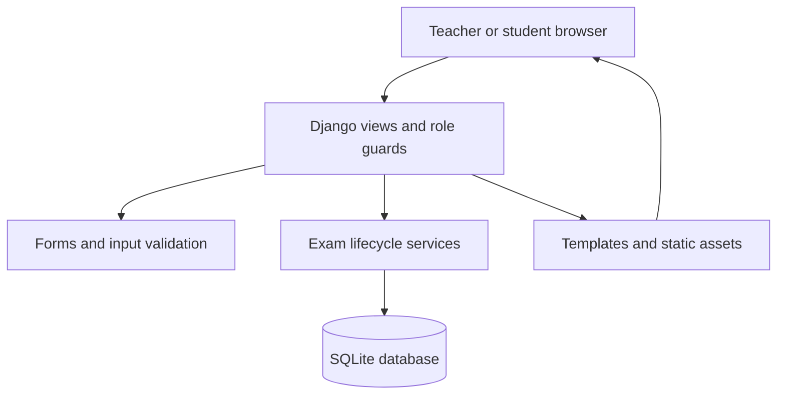

# Architecture and invariants

## Request flow

Django sessions and CSRF middleware cover state-changing browser requests. Every app view requires authentication except sign-in and student registration. Teacher provisioning is a management command or a trusted Django administrator action.

## Data model

| Model          | Relationships and responsibility                                                         |
| -------------- | ---------------------------------------------------------------------------------------- |
| User / Profile | Django's hashed-password account; profile stores student/teacher role                    |
| Course         | One teacher owns a class; random join code allows enrollment                             |
| Enrollment     | Unique pair of course and student                                                        |
| Exam           | Belongs to a course; stores publication, duration, availability and result-release state |
| Question       | Belongs to an exam; choice options/key or a written prompt, points and explanation       |
| Attempt        | Unique exam/student pair; immutable stored start/deadline, revision and submission state |
| Answer         | Unique attempt/question pair; response, awarded points and teacher feedback              |
| LoginThrottle  | Shared-database counter for failed sign-ins by username/address hash                     |

## Authorization boundaries

| Operation                                        | Enforcement                                                                      |
| ------------------------------------------------ | -------------------------------------------------------------------------------- |
| Teacher edits an exam/question or exports grades | Role guard plus `course__teacher=request.user` object lookup                     |
| Student sees an exam introduction                | Published exam plus enrollment lookup                                            |
| Student starts an exam                           | Role guard, enrollment, publication and time window checked on server            |
| Student reads/saves an attempt                   | Attempt lookup includes the signed-in student                                    |
| Student receives answer keys                     | Result template renders them only after submission, complete grading and release |
| New account requests teacher/staff role          | Such posted fields are ignored; only allowed registration fields are saved       |

Guessed identifiers do not grant access. Request payloads never supply scores, a trusted deadline, or a student identity.

## Attempt lifecycle

1. `start_attempt()` locks the exam in a transaction, checks enrollment/window, and returns an existing attempt if one exists. Otherwise it creates the attempt and blank answer rows. A unique constraint is the final duplicate-attempt guard.
2. The deadline is recorded once as `min(start + duration, closes_at)` when a close exists. Refreshing or starting again does not extend it.
3. `save_answers()` locks the attempt and checks submission/deadline before accepting changes. It validates that every supplied question belongs to that attempt and that response types/ranges are valid.
4. Each accepted save checks and increments a revision. Out-of-order/stale writes receive a conflict. All answer changes are in one transaction; one invalid response rolls back the whole save.
5. Submission grades choice answers and locks the response set. Repeated submissions return the existing result. Expiration uses saved responses and records the stored deadline, not the later cleanup time.
6. Teachers grade written responses with `0 <= awarded <= question.points`. Results stay private until all responses have a score and the teacher explicitly releases them.

With SQLite, `select_for_update()` alone is not a row lock. This project configures `transaction_mode=IMMEDIATE`, which acquires SQLite's write reservation at the start of each atomic transaction. This serializes writes at the database level. It is suitable for a small single-host deployment; PostgreSQL and load testing are the next step for higher write volume.

## Browser behavior

The autosave controller debounces inputs and also retries periodically. It serializes requests, retains dirty state until acknowledged, and sends a pending submission after an in-flight autosave completes. HTTP 409 freezes the stale tab and asks for a reload; it never silently picks a winning answer. Network failures remain visible. The timer derives an initial duration from server timestamps and advances with a monotonic browser clock, but the server deadline is always authoritative.

Published assessments are frozen through application routes. Trusted operators with direct database access can still change records; the app does not claim protection against its own administrator.

## Testing map

- `classroom/tests/test_workflows.py`: database-backed security, lifecycle, scoring, validation, CSV, authentication and demo checks.
- `scripts/browser_smoke.cjs`: a complete two-user browser journey against a temporary database, plus viewport and console checks.
- `.github/workflows/ci.yml`: backend matrix and browser execution on GitHub Actions.

## Deliberate boundaries

The system assigns an exam to all enrolled students in its class and allows one attempt. Questions support four-option single-answer choice or teacher-graded text. Attachments, question imports, randomization, retakes, per-student accommodations, email/reset flows and external identity providers would each require explicit product and data-model work.
