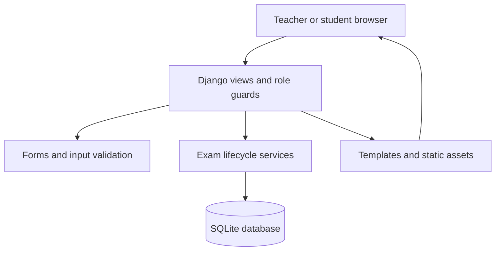

# Architecture and invariants

## Request flow

Django sessions and CSRF middleware cover state-changing browser requests. Every app view requires authentication except sign-in and student registration. Teacher provisioning is a management command or a trusted Django administrator action.

## Data model

| Model          | Relationships and responsibility                                                         |
| -------------- | ---------------------------------------------------------------------------------------- |
| User / Profile | Django's hashed-password account; profile stores student/teacher role                    |
| Course         | One teacher owns a class; join code and invitation state control new enrollment          |
| Enrollment     | Unique pair of course and student                                                        |
| Exam           | Belongs to a course; stores publication, duration, availability and result-release state |
| Question       | Belongs to an exam; choice options/key or a written prompt, points and explanation       |
| Attempt        | Unique exam/student pair; stored deadline, answer/grading revisions and submission state |
| Answer         | Unique attempt/question pair; response, review flag, awarded points and teacher feedback |
| LoginThrottle  | Shared-database counter for failed sign-ins by username/address hash                     |

## Authorization boundaries

| Operation                                        | Enforcement                                                                      |
| ------------------------------------------------ | -------------------------------------------------------------------------------- |
| Teacher edits an exam/question or exports grades | Role guard plus `course__teacher=request.user` object lookup                     |
| Student sees an exam introduction                | Published exam plus enrollment lookup                                            |
| Student starts an exam                           | Role guard, enrollment, publication and time window checked on server            |
| Student reads/saves an attempt                   | Attempt lookup includes the signed-in student                                    |
| Student receives answer keys                     | Result template renders them only after submission, complete grading and release |
| New account requests teacher/staff role          | Such posted fields are ignored; only allowed registration fields are saved       |

Guessed identifiers do not grant access. Request payloads never supply scores, a trusted deadline, or a student identity.

## Attempt lifecycle

1. `start_attempt()` locks the exam in a transaction, checks enrollment/window, and returns an existing attempt if one exists. Otherwise it creates the attempt and blank answer rows. A unique constraint is the final duplicate-attempt guard.
2. The deadline is recorded once as `min(start + duration, closes_at)` when a close exists. Refreshing or starting again does not extend it.
3. `save_answers()` locks the attempt and checks submission/deadline before accepting changes. It validates that every supplied question belongs to that attempt and that response types/ranges are valid.
4. Each accepted save checks and increments a revision. Out-of-order/stale writes receive a conflict. All answer changes are in one transaction; one invalid response rolls back the whole save.
5. Submission grades choice answers and locks the response set. Repeated submissions return the existing result. Expiration uses saved responses and records the stored deadline, not the later cleanup time.
6. Teachers grade written responses with `0 <= awarded <= question.points`. A separate grading revision rejects stale review forms without interfering with student autosave revisions. All written grades and feedback are validated and saved in one transaction. Results stay private until all responses have a score and the teacher explicitly releases them.

Review flags share the answer save transaction and revision. They can neither add questions from another exam nor change a score. Submitted or late flag changes are ignored under the same rules as answer changes.

With SQLite, `select_for_update()` alone is not a row lock. This project configures `transaction_mode=IMMEDIATE`, which acquires SQLite's write reservation at the start of each atomic transaction. This serializes writes at the database level. It is suitable for a small single-host deployment; PostgreSQL and load testing are the next step for higher write volume.

## Browser behavior

The autosave controller debounces inputs and also retries periodically. It serializes requests, retains dirty state until acknowledged, and sends a pending submission after an in-flight autosave completes. HTTP 409 freezes the stale tab and asks for a reload; it never silently picks a winning answer. Network failures remain visible. The timer derives an initial duration from server timestamps and advances with a monotonic browser clock, but the server deadline is always authoritative.

Request bodies are measured as UTF-8 bytes. Bodies up to 60,000 bytes use `keepalive`; larger saves use an ordinary request to avoid the [Fetch Standard's keepalive quota](https://fetch.spec.whatwg.org/#http-network-or-cache-fetch). A large Arabic response can exceed that quota even when its character count is much smaller. Keep the page open until the save is acknowledged; no background request guarantees delivery after the browser exits.

The server accepts request bodies up to 2.1 MB, enough for 50 answers of 10,000 Unicode characters encoded directly in UTF-8 plus JSON overhead. Per-answer validation and the 50-question builder limit still apply. Unusually verbose escaped JSON can exceed the body limit; the browser sends compact UTF-8 JSON.

Question navigation and review marks derive their display from the current form values. Both keyboard and pointer navigation move focus to the selected question; colors are supplemented with descriptive accessible labels and mark counts.

Published assessments are frozen through application routes. Trusted operators with direct database access can still change records; the app does not claim protection against its own administrator.

## Teacher workflows

An exam's owner can preview draft or published questions with the same answer controls used by students. Preview hides answer keys and explanations, and responses exist only in the current page. The GET/HEAD-only route creates no attempts or answers; its separate browser controller supports navigation and reset without calling autosave or submission endpoints.

Exam duplication copies question rows into a new draft and resets the schedule, publication and release state. It never copies attempts or answers. Draft question moves lock the parent exam, swap adjacent rows, and normalize positions. Invitation changes and student joins lock the course; pausing or rotating a code preserves existing enrollments.

The gradebook combines enrolled students with existing attempts so missing submissions and historical records remain visible. Search/status filters are applied to that common row set. Pagination affects the HTML view only; CSV exports contain every matching row, and summary statistics use the full class. Answers are prefetched so graded-state checks do not add one query per student.

## Testing map

- `classroom/tests/test_workflows.py`: database-backed security, lifecycle, scoring, validation, CSV, authentication and demo checks.
- `classroom/tests/test_duplication.py`, `test_ordering.py`, `test_invitations.py`, and `test_gradebooks.py`: teacher workflows, data isolation, filtering/pagination/export, and bounded gradebook queries.
- `classroom/tests/test_preview.py`: preview permissions, hidden keys, question order, escaping, and isolation from student answers and grades.
- `classroom/tests/test_review_flags.py`, `test_grading_revisions.py`, and `test_large_saves.py`: persisted marks, stale review protection, transactional grading, and large UTF-8 request bodies.
- `scripts/browser_smoke.cjs`: a complete two-user browser journey against a temporary database, plus viewport and console checks.
- `.github/workflows/ci.yml`: backend matrix and browser execution on GitHub Actions.

## Deliberate boundaries

The system assigns an exam to all enrolled students in its class and allows one attempt. Questions support four-option single-answer choice or teacher-graded text. Attachments, question imports, randomization, retakes, per-student accommodations, email/reset flows and external identity providers would each require explicit product and data-model work.
